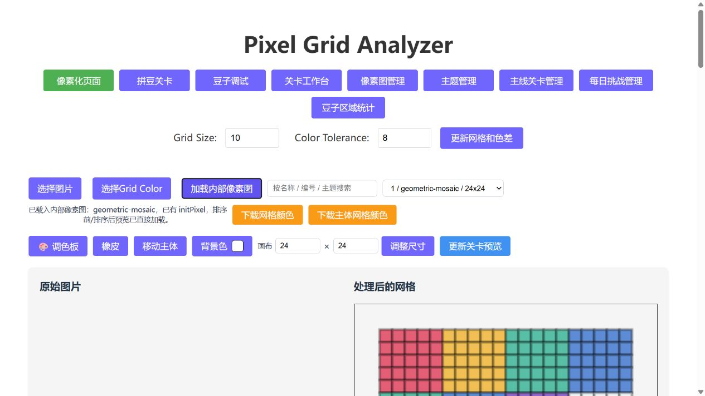

# Pixel Dev Tool

[English](README.md) · [贡献说明](CONTRIBUTING.md) · [MIT 许可证](LICENSE)

面向像素画和拼豆解谜游戏的本地关卡制作工具。把网格识别、像素编辑、拼豆预览、初始布局生成和关卡配置管理放在一个 React + TypeScript 应用中。

这是从实际开发工具中整理的早期开源版本，界面目前以中文为主。附带的图片、拼豆和关卡均为新制作的几何示例，不包含生产素材、实际游戏关卡、密钥或内部开发历史。



## 功能

- 图片网格识别、颜色采样、主体提取和像素编辑。
- 拼豆预览、资源颜色匹配和图层调试。
- 支持随机种子复现的结构感知、区域重染色等关卡布局算法。
- 像素图、主题、主线关卡及每日挑战配置编辑。
- 本地草稿、JSON 导入导出、缩略图、备份及关卡阅览页生成。

## 启动

安装 Node.js 22 或更高版本：

```sh
git clone https://github.com/diandongtx/pixel-dev-tool.git
cd pixel-dev-tool
npm ci --include=dev
npm run dev
```

打开终端显示的本地地址，通常是 `http://127.0.0.1:5173`。主工具不需要 API Key，也不依赖外部生图服务。

工作数据保存在 `data/level-workspace/`，缩略图在 `resource/thumbnail/`，阅览产物在 `output/`；这些内容不会提交到 Git。

完整功能需要使用 `npm run dev`：本地文件接口由 Vite 开发插件提供。`npm run build` 只构建前端；`npm run preview` 或静态网站托管不提供本地工作区接口。保持默认的 `127.0.0.1` 监听地址；当前版本是单人本地工具，没有多用户登录机制。

## 第一次体验

1. 在「像素化页面」选择 `examples/geometric-mosaic.png`，示例原图每格为 10 × 10 像素。
2. 在「关卡工作台」导入 `examples/geometric-mosaic-map.json`，体验随项目提供的六色拼豆资源匹配。
3. 在「像素图管理」导入 `examples/pixelconfig.json`，再到「主线关卡管理」导入 `examples/levelconfig.json`。需要写入本地工作区时，使用页面上的保存操作。

示例用于演示数据格式，不代表经过调优的游戏关卡。布局生成会给出质量指标，未达标的结果需要人工检查或重新生成。

执行 `npm run samples:generate` 可以重新生成几何图片、拼豆、调试图层和示例 JSON。该命令只改写 `examples/`、`resource/grid/` 和 `public/beads/` 中的演示文件，不会覆盖本地工作区。素材来源见 [ASSETS.md](ASSETS.md)。

## 开发与限制

```sh
npm test
npm run build
npm run lint
```

测试使用合成样例和临时目录。原开发项目中依赖私有关卡的回归用例没有随仓库公开；本版用独立几何样例验证颜色数量守恒、背景保留、随机种子复现和分块行为。CI 在 Windows 和 Linux 上执行测试和构建。

`src/` 为主工具代码，`tooling/` 为本地接口，`examples/` 为公开示例。独立 AI 生图实验管线暂不包含在此版本中。

代码及新生成的演示素材使用 [MIT 许可证](LICENSE)。第三方依赖保留各自许可证；你导入的素材不自动变成本项目的 MIT 授权素材。
