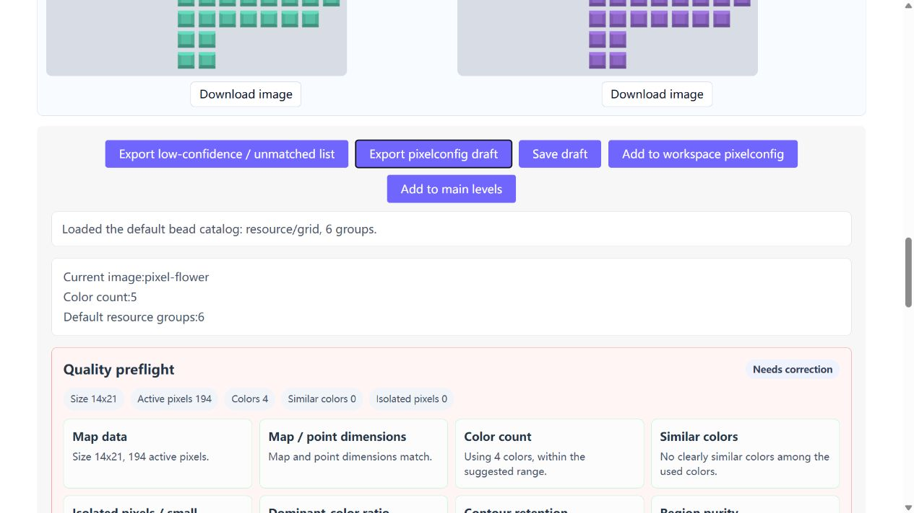
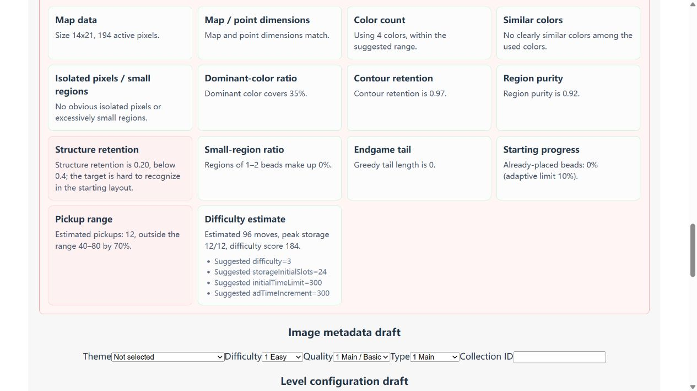

# First-run walkthrough

Allow 10–15 minutes. Install Node.js 22+, run `npm ci --include=dev` and `npm run dev`, then open the local URL printed in the terminal.

1. On **Pixel editor**, use **Choose image** to load `examples/pixel-flower.png`. This original procedural flower has 24 × 24 cells at 10 pixels per cell.
2. Compare the processed grid with the input. Choose a palette color and edit a cell; **Eraser** erases a cell to transparency.
3. Click **Update level preview** and inspect the bead resource preview below the editor.
4. Enter a seed such as `7`, then click **Generate starting layout**. Review both the starting layout and quality metrics; a candidate is not guaranteed to meet every criterion.
5. Use **Download starting grid (point)** to export the starting grid and **Download subject grid** for the target grid. **Export pixelconfig draft** exports the pixel configuration from the preview panel.
6. **Save draft** persists the draft in the local workspace. Pixel and main-level editors support further configuration. The separate `examples/pixelconfig.json` and `examples/levelconfig.json` pair demonstrates the mosaic's complete configuration format.

If detection chooses an incorrect cell size, set **Grid Size** to `10` and update. Alternatively, import `examples/pixel-flower-map.json` via **Import grid JSON** to try editing and generation independently of image detection.

Please submit [first-run feedback](https://github.com/diandongtx/pixel-dev-tool/issues/new?template=tryout.yml): your environment, how far you got, what you wanted to make, and one useful improvement. Failed attempts are valuable too. Only share inputs you are authorized to publish. Private feedback is not automatically treated as a public testimonial.

This is a local authoring tool, not a playable game. The filesystem API requires the development server. Synthetic demos show the workflow, not accuracy on arbitrary images or validated game difficulty.

## English interface and preflight

The interface defaults to English. The header language selector also offers Chinese; save before switching because the page reloads. Existing JSON field names, IDs, and user-entered names remain unchanged.

The unedited flower with seed 7 exports 194 beads in a 14 × 21 subject grid. Color counts and empty positions match between target and starting grids. Quality warnings still need review.

## Earlier walkthrough

The v0.1.0 Chinese-interface [60-second walkthrough](https://github.com/diandongtx/pixel-dev-tool/releases/download/v0.1.0/pixel-dev-tool-walkthrough.mp4) is assembled from real operation screenshots, not a continuous screen recording. It changes one pink cell to yellow and uses seed 7. The exported subject is 14 × 21 with 194 beads; exported and saved data were checked for matching color counts and background positions.

The generator pass indicator and combined quality preflight use different metrics. This demo still raises structure-retention and operation-band warnings in the combined preflight. Treat it as a workflow draft, not a tuned level, and review both panels.
